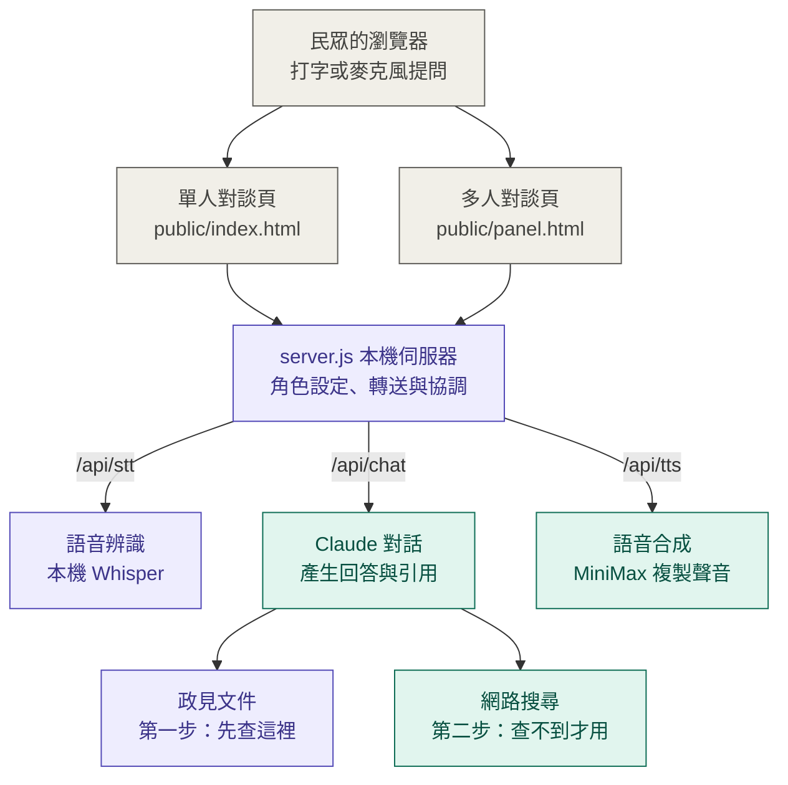
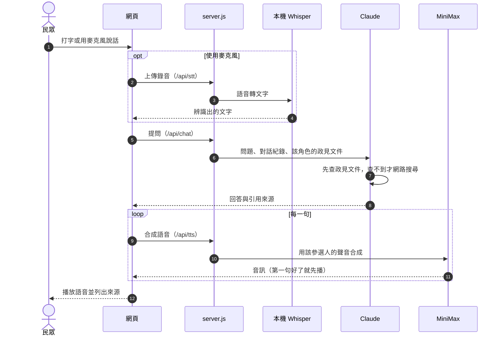

# 花蓮縣長參選人 AI 語音對談（實驗原型）

讓民眾用打字或麥克風，向三位花蓮縣長參選人的 AI 角色提問，AI 以經授權的複製聲音回答，並附上政見出處。

專案目標：實驗透過 AI 工具，讓候選人不受地理、時間的限制，即時回答民眾的提問，並蒐集民眾的問題和需求，作為政策調整的依據。

> **這是私人試用的實驗原型。** 回答由 AI 根據政見資料與網路搜尋生成，不代表候選人本人即時發言或立場。介面與每段對話開頭都會標示 AI 身分。完整的產品需求與驗收標準見 [SPEC.md](SPEC.md)。

## 功能

- **單人對談**：每位參選人各有一頁，可以打字或用麥克風提問，回答以本人的複製聲音播放。
- **多人對談**：三位同頁，可以問單一人或全體；全體時依序回答，下一位會看到前一位的發言。也可以按「請他回應」，請某人回應其他人的說法。
- **先查政見、再上網**：每位參選人有自己的政見文件，回答先根據文件，查不到才使用網路搜尋。
- **標示出處**：每則回答下方列出來源，分成「官網政見」「媒體報導整理」「網路」三種，可以展開引用的原文。
- **本機語音辨識**：麥克風的語音在本機用 Whisper 轉成文字，不送到外部服務，所有瀏覽器都能用。
- **聽得懂台語**：可以用台語提問，回答一律用華語（語音合成不支援台語）。
- **隨時打斷**：角色說話時可以按「停止」、按 Esc，或直接開口打斷。

## 系統架構



紫色是在本機執行的部分，綠色是需要連網的雲端服務。

### 一次提問的流程



1. 民眾在單人頁或多人頁打字，或用麥克風說話。
2. 使用麥克風時，錄音先在本機用 Whisper 轉成文字，錄音不會離開這台電腦。
3. 伺服器把問題、對話紀錄和這位參選人自己的政見文件交給 Claude。Claude 先查政見文件，文件沒有才上網搜尋，回答時標出引用的出處。
4. 回答以串流方式傳回（`/api/chat-stream`），文字即時顯示；Claude 每寫完一句就交給 MiniMax 用這位參選人的複製聲音合成，第一句好了就先播，不必等整段回答寫完（`public/chat-stream.js`）。
5. 多人對談時，下一位會在前一位說話時先準備好回答，前一位說完就接著播，一次只有一個人說話。

| 元件 | 使用的服務 |
| --- | --- |
| 對話模型 | Claude（預設 `claude-opus-5`），透過 `@anthropic-ai/sdk` |
| 語音合成與聲音複製 | MiniMax（國際版）`speech-2.8-hd` |
| 語音辨識 | 本機 Whisper：Mac 用 mlx-whisper（`whisper-large-v3-turbo`），Linux 伺服器用 faster-whisper（`base`，只用 CPU） |

## 環境需求

- Node.js 21.7 以上
- Apple 晶片的 Mac（本機語音辨識使用 mlx-whisper）
- [uv](https://docs.astral.sh/uv/)、ffmpeg（語音辨識服務需要）
- Anthropic API key、MiniMax API key，以及各參選人在 MiniMax 複製好的 voice ID

不需要麥克風功能時，可以把 `STT_AUTOSTART` 設為 `false`，就不需要 uv、ffmpeg 與 Apple 晶片。

## 安裝與啟動

```bash
npm install
cp .env.example .env
```

打開 `.env`，填入 API key 與各參選人的 voice ID（見下方設定說明），然後啟動：

```bash
npm start
```

啟動後終端機會顯示各角色是否啟用、載入了哪些政見文件，以及「語音辨識：已就緒」。

| 頁面 | 網址 |
| --- | --- |
| 單人對談（預設角色） | http://localhost:3000 |
| 指定參選人 | http://localhost:3000/?c=wei_chia_hsien（`c=` 後面換成角色 id） |
| 多人對談 | http://localhost:3000/panel.html |

### 用手機開啟

瀏覽器規定只有 HTTPS 網頁才能使用麥克風，所以伺服器會另外開一個 HTTPS 埠（預設 3443），並在第一次啟動時用 openssl 自動產生自簽憑證（存在 `certs/`，不進版本控制）。

1. 手機和這台電腦連同一個 Wi-Fi。
2. 打開終端機啟動訊息中「手機（同一個 Wi-Fi）」那行的網址，例如 `https://192.168.x.x:3443/panel.html`。
3. 第一次會出現「連線不是私人連線」的警告，這是自簽憑證的正常提示：Safari 點「顯示詳細資訊」→「瀏覽此網站」；Chrome 點「進階」→「繼續前往」。
4. 允許使用麥克風後即可對談；勾選「連續對談」，角色說完會自動開始聽下一個問題。

- 手機版面：輸入框與「送出」一列、麥克風與「停止」一列，其他設定在下方。
- iPhone 只允許「點擊過」的播放器自動播放，所以頁面在第一次點擊時會解鎖播放器；之後連續對談時角色的聲音才能自動播出。
- 換了網路、電腦 IP 改變時，刪掉 `certs/` 再重新啟動，會重新產生涵蓋新 IP 的憑證。
- 同一個 Wi-Fi 上的任何人都能連到這個網址並使用（會消耗 API 額度），請只在信任的網路使用。

注意：

- 伺服器要一直開著。請在專用的終端機分頁執行 `npm start`，不要在同一個分頁輸入其他指令，否則伺服器可能被中斷。
- 第一次啟動語音辨識時，如果本機沒有快取的套件，會自動下載（約 200 MB 以上），需要幾分鐘。
- 修改 `server.js`、`.env`、`characters.json` 或 `knowledge/` 之後，要重新啟動才會生效；只改 `public/` 裡的網頁時，重新整理瀏覽器即可。

### 在 Linux 伺服器上使用麥克風

mlx-whisper 只能在 Apple 晶片上執行。Linux 伺服器改用 faster-whisper，另外啟動語音辨識服務，並在 `.env` 設 `STT_AUTOSTART=false`：

```bash
python3 -m venv stt-venv
stt-venv/bin/pip install -r stt/requirements-linux.txt   # 另需 ffmpeg
STT_BACKEND=faster-whisper STT_MODEL=base stt-venv/bin/python stt/stt_server.py
```

- `STT_MODEL` 可用 `base`（較快，目前使用）或 `small`（較準）。1 顆 CPU 上，7 秒的提問 `base` 約 2 秒、`small` 約 5.5 秒辨識完。
- 第一次啟動會下載模型（`small` 約 500 MB）。

## 設定（.env）

| 變數 | 說明 | 預設 |
| --- | --- | --- |
| `ANTHROPIC_API_KEY` | Claude API key | 必填 |
| `CLAUDE_MODEL` | 對話模型 | `claude-opus-5` |
| `CLAUDE_EFFORT` | 思考深度：`low` / `medium` / `high` / `xhigh` / `max`；閒聊用 `low` 回應較快 | `low` |
| `MINIMAX_API_KEY` | MiniMax API key | 必填 |
| `MINIMAX_VOICE_ID` | 魏嘉賢的 voice ID | |
| `MINIMAX_VOICE_ID_YU_SHU_CHEN` | 游淑貞的 voice ID | |
| `MINIMAX_VOICE_ID_CHANG_CHUN` | 張峻的 voice ID | |
| `MINIMAX_BASE_URL` | 國際版 `https://api.minimax.io/v1`；中國大陸版帳號改用 `https://api.minimaxi.com/v1` | 國際版 |
| `MINIMAX_TTS_MODEL` | 語音合成模型；改成 `speech-2.8-turbo` 會比較快，但品質可能下降 | `speech-2.8-hd` |
| `MINIMAX_TTS_SPEED` | 語速 0.5～2 | `1` |
| `PORT` | 網頁伺服器埠號 | `3000` |
| `HTTPS` | 是否另開 HTTPS 埠（手機用麥克風需要） | `true` |
| `HTTPS_PORT` | HTTPS 埠號 | `3443` |
| `STT_AUTOSTART` | 是否隨伺服器自動啟動本機語音辨識 | `true` |
| `STT_URL` | 語音辨識服務位址 | `http://127.0.0.1:3010` |
| `DAILY_LIMIT_PER_IP` | 每個 IP 每天可呼叫 Claude 的次數（多人對談問全體算三次）；`0` 不限制 | `60` |
| `DAILY_LIMIT_TOTAL` | 所有人每天合計的上限；`0` 不限制。次數存在記憶體，重新啟動會歸零 | `300` |
| `HOST` | 網頁伺服器監聽位址；部署到伺服器、前面有 Apache 時設成 `127.0.0.1` | 所有介面 |
| `WEB_SEARCH_TOOL` | 網路搜尋工具版本；預設的基本版會附逐句引用 | `web_search_20250305` |
| `TTS_TEST_MODE` | 開發用：顯示「朗讀測試」開關，可讓角色聲音直接朗讀任意文字。**私人試用前必須設為 `false`** | `false` |
| `DEMO_CHARACTERS` | 開發用：多人對談頁以虛構測試角色代替未啟用的參選人 | `false` |

`.env` 含有 API key，不可提交到版本控制（已列入 `.gitignore`）。

## 角色與政見資料

### 角色設定：characters.json

每位角色一筆資料。參選人的 `enabled` 為 `false` 時只會顯示「未啟用」，不能對話；**只有取得本人同意與聲音授權後才可以啟用**。

```json
{
  "id": "chang_chun",
  "name": "張峻",
  "title": "花蓮縣長參選人",
  "kind": "candidate",
  "enabled": true,
  "voiceIdEnv": "MINIMAX_VOICE_ID_CHANG_CHUN"
}
```

`kind` 為 `demo` 的是虛構測試角色，只在 `DEMO_CHARACTERS=true` 時出現，使用 MiniMax 內建聲音，不代表任何真實人物。

### 政見文件：knowledge/&lt;角色 id&gt;/*.md

每位角色只讀得到自己資料夾的文件。文件開頭用 `---` 包住資訊欄位：

```markdown
---
title: 魏嘉賢競選官網政見與政績
origin: official
source: https://lovehualien.com/
source_type: 候選人官方網站（本人發布）
retrieved: 2026-10-04
---

## 政見標題

- 一行一個重點，回答時會引用到單一行。
```

- `origin: official`：本人發布的內容（例如競選官網），頁面標示「官網政見」。
- `origin: media`：從新聞整理的暫時版本，頁面標示「媒體報導整理」，AI 會說「根據某某媒體某月某日的報導」。每一行後面要用括號標註報導媒體與日期。
- 文件一行一個重點。系統依行切段讓 Claude 精準引用（內建的分句對中文切得太粗）。

目前的資料：

| 參選人 | 文件 | 類型 |
| --- | --- | --- |
| 魏嘉賢 | `knowledge/wei_chia_hsien/lovehualien.md` | 競選官網政見與政績（官方） |
| 游淑貞 | `knowledge/yu_shu_chen/news-summary.md` | 媒體報導整理（暫時版本） |
| 張峻 | `knowledge/chang_chun/news-summary.md` | 媒體報導整理（暫時版本） |

游淑貞與張峻的白皮書全文未在網路公開，收到團隊提供的正式資料後，應整理成 `origin: official` 的文件取代暫時版本。

### 照片與說話中的卡通圖

圖片放在 `public/images/`，副檔名可用 `.jpg`、`.jpeg`、`.png`、`.webp`，重新整理頁面即會顯示：

| 檔名 | 用途 |
| --- | --- |
| `<角色 id>.jpg` | 照片，顯示在回答旁的小頭像 |
| `<角色 id>-cartoon.png` | 卡通圖（閉嘴），有的話取代照片當作大頭像 |
| `<角色 id>-cartoon-talk.png` | 卡通圖（張嘴），角色說話時依音量與閉嘴圖切換，看起來像在講話 |

- 兩張卡通圖要同樣大小、同樣構圖，只差在嘴巴，切換時才自然。建議用正方形、臉在中間。
- 沒有卡通圖時，說話中的角色會以光環與輕微縮放表示，不會在真人照片上加嘴型動畫。
- 動畫由 `public/talking-avatar.js` 依播放音量驅動。

### 新增一位參選人

1. 取得本人同意、聲音授權，在 MiniMax 複製聲音，取得 voice ID。
2. 在 `.env` 加上 voice ID，在 `characters.json` 新增角色並設 `enabled: true`。
3. 把政見文件放進 `knowledge/<角色 id>/`，照片放進 `public/images/`。
4. 重新啟動伺服器。

## AI 的回答規則

每位參選人角色的規則定義在 `server.js` 的 `candidatePrompt()`，重點如下：

- 以第一人稱回答，但只限資料明確記載是本人說過、提出過或做過的事，並口頭交代出處與時間。
- 記者分析與他人評論不能說成本人發言；查不到就說查不到，不編造立場、數字或承諾。
- 不提供投票建議，不評比、推薦或攻擊任何候選人；多人對談時只根據自己的資料回應別人的說法。
- 每段對話第一次發言時，先說明「我是以某某聲音呈現的 AI 實驗角色，不代表本人即時發言」。
- 原型不保存對話，因此不會說「我會記下來」這類做不到的話。

## 已知限制

- 多人對談一次只播放一位，依序回答；全體回答時要等每位說完。
- 自己錄音辨識時看不到即時文字；用「開口即打斷」時，第一個字可能沒錄到。用喇叭可能被誤打斷，建議戴耳機。
- 口頭提到的報導日期偶爾不準確，以頁面列出的來源日期為準。
- 三位參選人的資料詳細程度不同（官方政見與媒體整理），回答的完整度也會不同。
- 原型目前不保存或蒐集對話內容。若要蒐集民眾問題，須先設計告知、同意、去識別化與保存期限。

## 安全與授權

- 只有取得本人同意與聲音授權的參選人才能啟用。授權範圍應涵蓋以本人聲音、以第一人稱呈現 AI 角色。
- 合成語音可能被擷取外流並誤認為本人發言；私人試用期間不提供音訊下載，並請試用者知悉此限制。
- 台灣《公職人員選舉罷免法》對候選人的深度偽造聲音影像有相關規範，公開前請法律專業確認。
- 公開或開放他人試用前，請將 `TTS_TEST_MODE`、`DEMO_CHARACTERS` 設為 `false`。

## 檔案結構

```text
server.js              伺服器：角色、對話、語音合成、語音辨識代理
characters.json        角色清單
knowledge/             各參選人的政見文件
public/index.html      單人對談頁
public/panel.html      多人對談頁
public/images/         參選人照片
stt/stt_server.py      本機語音辨識服務（mlx-whisper）
stt/requirements.txt   語音辨識套件版本（固定版本以便離線啟動）
SPEC.md                產品需求與驗收標準
.env.example           設定範本
```
